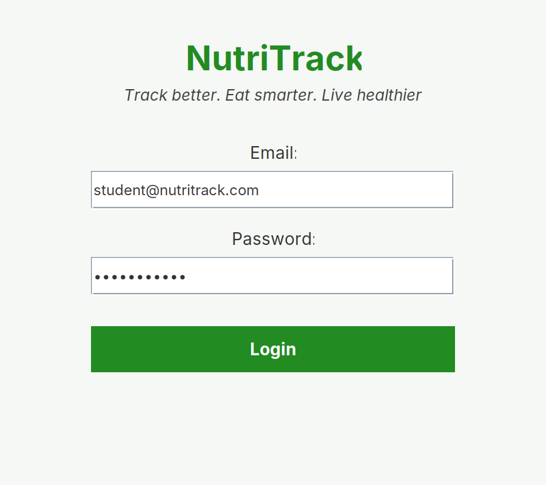
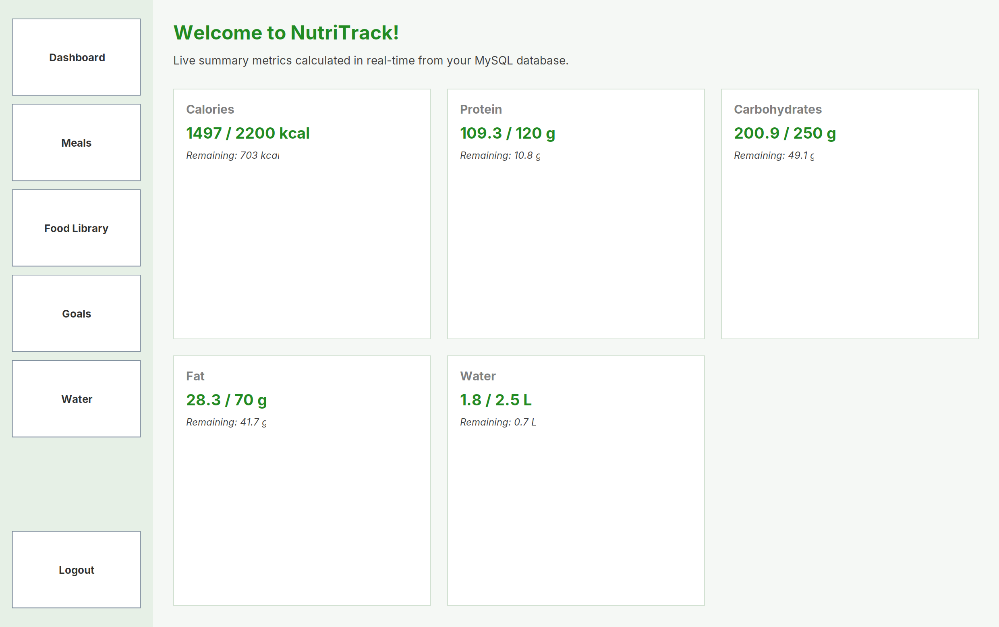
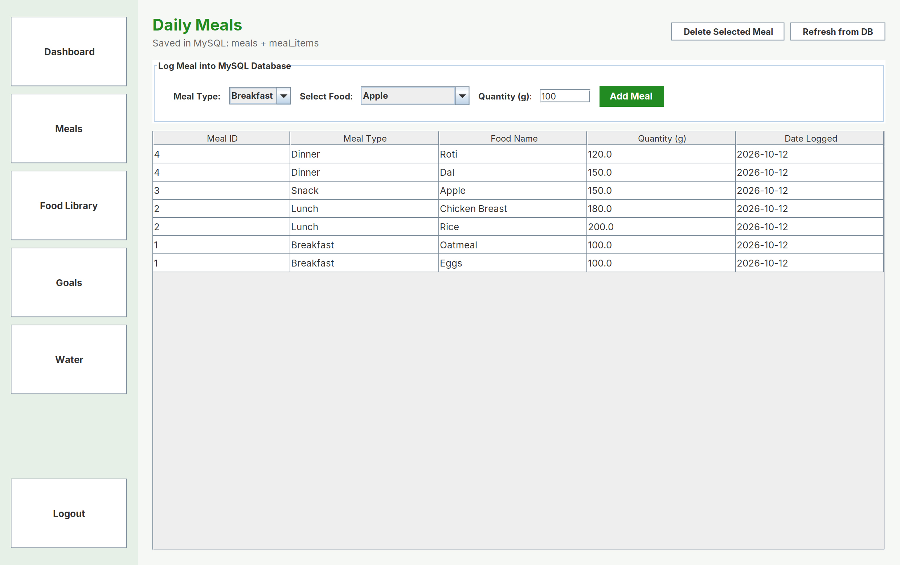
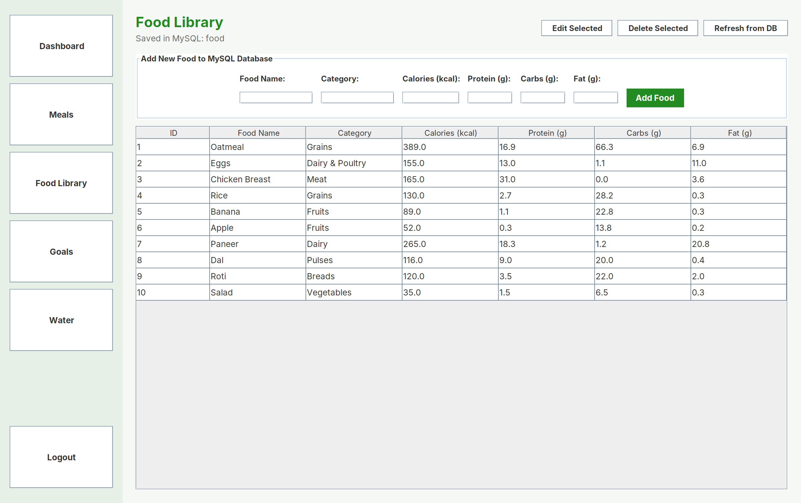
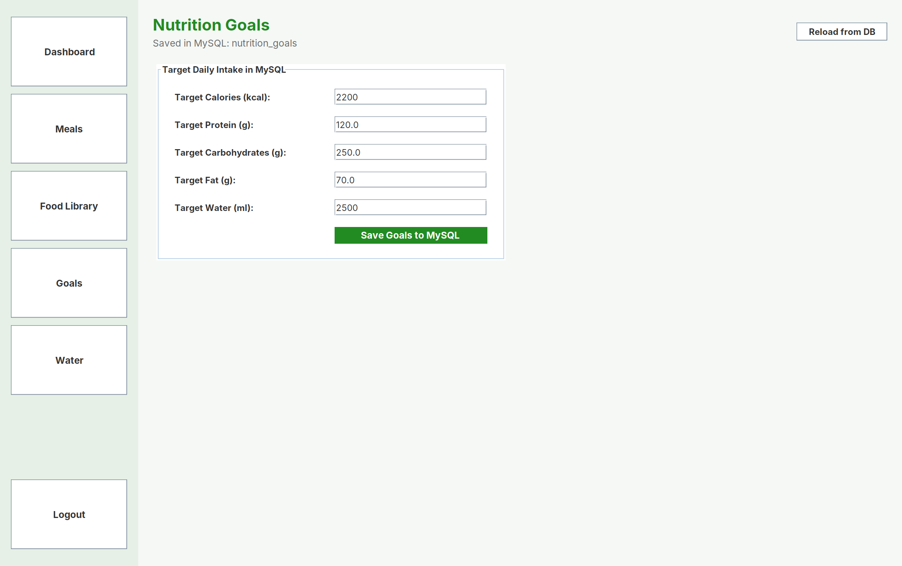
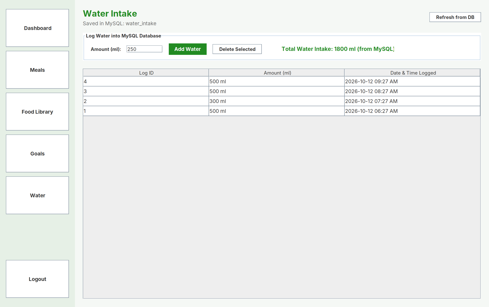

# NutriTrack – Personal Nutrition & Wellness Manager
group 16

A desktop app for tracking meals, water intake and daily nutrition goals, built with **Java Swing**, **JDBC** and **MySQL**. It uses plain Java only, with no frameworks and no build tool.

  

**Demo login:** `student@nutritrack.com` / `password123` (created by the SQL script)

---

## Screenshots

| Login | Dashboard | Meals |
|---|---|---|
|  |  |  |

| Food Library | Goals | Water |
|---|---|---|
|  |  |  |

---

## Features

- **Login and sign-up.** Passwords are stored as SHA-256 hashes, and every user sees only their own data.
- **Dashboard.** Today's calories, protein, carbs, fat and water are shown as colour-coded progress bars.
- **"What should I eat next?"** The app finds your biggest nutrient gap and suggests three foods with amounts.
- **Meals.** Log foods into Breakfast, Lunch, Snack or Dinner, and browse any past day.
- **Food Library.** Add, edit, delete and search foods (values are per 100 g).
- **Water.** Use quick +250 / +500 / +750 ml buttons alongside a daily progress bar.
- **Goals.** Set daily targets by hand or with the Smart Goal Calculator.
- **Profile.** Shows your BMI with its category and your BMR, and suggests goals using the Mifflin-St Jeor formula.
- **Weekly Report.** A hand-drawn bar chart of the last 7 days with the weekly average, best day and logging streak.
- **Export.** Save today's report as TXT or CSV into the `reports/` folder.
- **Water reminder.** A background thread checks your water intake 1 minute after login and then every 30 minutes, and reminds you if you are behind your goal.
- **Responsive UI.** Dashboard data loads on a `SwingWorker` background thread, so the window never freezes.

---

## Architecture

```text
gui  --->  service  --->  dao (interface)  --->  dao.impl (JDBC)  --->  MySQL
            model, exception and util are used by all layers
```

```text
NutriTrack/
├── src/
│   ├── Main.java              entry point
│   ├── model/                 plain data classes (User, Food, Meal, MealItem, NutritionGoal, ...)
│   ├── dao/                   DAO interfaces: WHAT can be done with each table
│   │   └── impl/              JDBC implementations: HOW it is done (all SQL lives here)
│   ├── service/               business logic: auth, nutrition totals, goal calculator, report exporters
│   ├── exception/             custom exception hierarchy (NutriTrackException + subclasses)
│   ├── util/                  Validator, Session, PasswordUtil (SHA-256)
│   ├── database/              DBConnection (reads config/db.properties)
│   └── gui/                   Swing frames and panels (no SQL)
├── config/
│   └── db.properties.example  template for your local database settings
├── sql/
│   └── nutritrack_schema.sql  tables + sample data
├── tools/
│   └── SmokeTest.java         console test of every DAO and service
├── lib/
│   └── mysql-connector-j.jar  MySQL JDBC driver (9.2.0)
├── screenshots/
├── run.sh                     compile + run on macOS / Linux
└── run.bat                    compile + run on Windows
```

---

## Getting Started

### Prerequisites

- **JDK 8 or newer**
- **MySQL 8 or newer**

### 1. Clone the repository

```bash
git clone https://github.com/akshat18-gg/PersonalNutrition_WellnessManager.git
cd PersonalNutrition_WellnessManager
```

### 2. Create the database

> **Warning:** the script drops and re-creates all NutriTrack tables. Any existing data in the `nutritrack` database is replaced with sample data.

```bash
mysql -u root -p < sql/nutritrack_schema.sql
```

You can also open `sql/nutritrack_schema.sql` in **MySQL Workbench** and run the whole file.

The sample meals and water entries cover the 7 days before the date you run the script. Re-run the script before a demo so the weekly chart and streak are full.

### 3. Configure your database credentials

Copy the template and set your own MySQL password:

```bash
cp config/db.properties.example config/db.properties      # macOS / Linux
copy config\db.properties.example config\db.properties    # Windows
```

```properties
db.url=jdbc:mysql://localhost:3306/nutritrack
db.user=root
db.password=your_mysql_password
```

`config/db.properties` is git-ignored, so your password is never committed.

### 4. Compile and run

**macOS / Linux**
```bash
bash run.sh
```

**Windows**
```cmd
run.bat
```

<details>
<summary>Compile and run by hand</summary>

macOS / Linux:
```bash
javac -encoding UTF-8 -d bin -cp "lib/mysql-connector-j.jar:src" src/Main.java src/database/*.java src/exception/*.java src/model/*.java src/util/*.java src/dao/*.java src/dao/impl/*.java src/service/*.java src/gui/*.java
java -cp "bin:lib/mysql-connector-j.jar" Main
```

Windows:
```cmd
javac -encoding UTF-8 -d bin -cp "lib\mysql-connector-j.jar;src" src\Main.java src\database\*.java src\exception\*.java src\model\*.java src\util\*.java src\dao\*.java src\dao\impl\*.java src\service\*.java src\gui\*.java
java -cp "bin;lib\mysql-connector-j.jar" Main
```
</details>

Always start the app **from the project root**, because `config/db.properties` and `reports/` are resolved relative to it.

---

## Smoke Test

`tools/SmokeTest.java` calls every DAO and service method against the database and prints `PASS` or `FAIL` for each check. It creates a temporary user and deletes it at the end, so the demo data is left unchanged.

After compiling the app:

```bash
# macOS / Linux
javac -d bin -cp "bin:lib/mysql-connector-j.jar" tools/SmokeTest.java
java -cp "bin:lib/mysql-connector-j.jar" SmokeTest
```

```cmd
:: Windows
javac -d bin -cp "bin;lib\mysql-connector-j.jar" tools\SmokeTest.java
java -cp "bin;lib\mysql-connector-j.jar" SmokeTest
```

The last line should say `ALL CHECKS PASSED`.

---

## Database Design

The `nutritrack` database has six relational tables, linked by primary and foreign keys:

| Table | Purpose | Foreign keys |
|---|---|---|
| `users` | Profile and login details (`password` is a SHA-256 hash) | — |
| `nutrition_goals` | Daily nutrition targets | `user_id` |
| `food` | Food library, values per 100 g | — |
| `meals` | One row per meal type per day | `user_id` |
| `meal_items` | Foods in each meal with quantity in grams | `meal_id`, `food_id` |
| `water_intake` | Water entries with date and time | `user_id` |

---

## Troubleshooting

| Problem | What to check |
|---|---|
| "NutriTrack could not connect to the database" | Is MySQL running? Does `config/db.properties` exist with the correct password? Did you run the SQL script? |
| "Incorrect email or password" for the demo account | Run `sql/nutritrack_schema.sql` again. An old database may still store the password as plain text. |
| Weekly chart is almost empty | The sample data is old. Run the SQL script again today. |
| `javac` is not recognized | Install a JDK and add its `bin` folder to your `PATH`. |
| Compilation error about a missing package | Use the full command above, which lists every package folder. |

---

## Tech Stack

- **Language:** Java (8+)
- **UI:** Swing / AWT
- **Database:** MySQL 8 via JDBC (MySQL Connector/J 9.2.0)
- **Concepts:** layered architecture (DAO pattern), interfaces and abstract classes, a custom exception hierarchy, multithreading (`SwingWorker`, background reminder thread), file I/O for exporting reports
